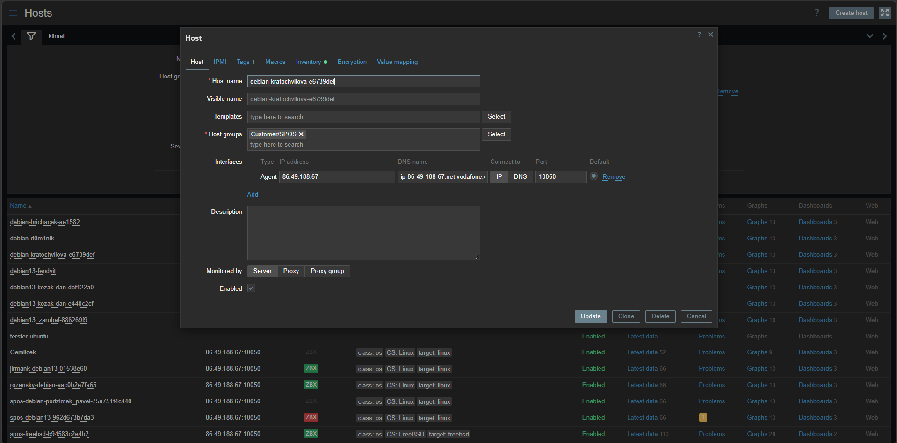
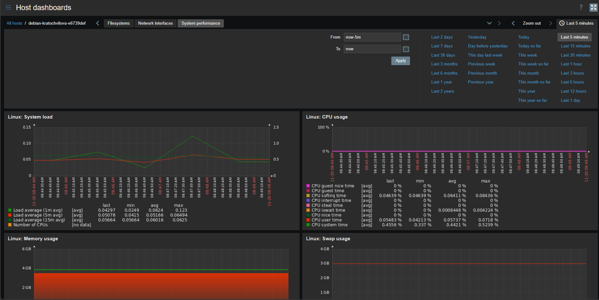

# OSY: automatická registrace Debianu 13 do Zabbixu


Tato varianta zadání používá box `bento/debian-13` a **Zabbix Agent 2 verze 8.0 LTS** instalovaný z oficiálního repozitáře Zabbix pro Debian 13. Vagrant automaticky spouští instalační a konfigurační skripty. Agent se připojuje k serveru `enceladus.pfsense.cz` a pro automatickou registraci odesílá `HostMetadata=SPOS`.

## Spuštění

```bash
vagrant validate
vagrant up
```

Po změně instalačních nebo konfiguračních skriptů lze znovu spustit provisioning:

```bash
vagrant provision
```

Připojení k virtuálnímu stroji:

```bash
vagrant ssh
```

Virtuální stroj používá Debian 13. Jedinečný název hosta je `debian-kratochvilova-e6739def`. Tento název se používá při registraci v Zabbixu a musí zůstat zachován i po restartu virtuálního stroje a opakovaném provisioningu.

## Instalace

Instalace probíhá automaticky pomocí Vagrant provisioningu. Nejprve se stáhne oficiální instalační balíček repozitáře Zabbix 8.0 určený pro Debian 13:

```bash
wget https://repo.zabbix.com/zabbix/8.0/release/debian/pool/main/z/zabbix-release/zabbix-release_latest_8.0+debian13_all.deb
```

Následně se přidá repozitář, aktualizuje seznam balíčků a nainstaluje Zabbix Agent 2:

```bash
dpkg -i zabbix-release_latest_8.0+debian13_all.deb
apt update
apt install -y zabbix-agent2
```

Používá se oficiální repozitář Zabbix 8.0 pro Debian 13, nikoli výchozí repozitář Debianu. Při instalaci byla ověřena verze balíčku `2:8.0.0-1+debian13`.

## Konfigurace agenta

Konfigurace probíhá úpravou souboru:

`/etc/zabbix/zabbix_agent2.conf`

Agent má nastavené následující parametry:

| Parametr | Hodnota |
|---|---|
| Server | `enceladus.pfsense.cz` |
| ServerActive | `enceladus.pfsense.cz` |
| Hostname | `debian-kratochvilova-e6739def` |
| HostMetadata | `SPOS` |

Parametr `Server` určuje adresu serveru pro pasivní kontroly. `ServerActive` nastavuje server pro aktivní kontroly, pomocí kterých agent zahajuje spojení se Zabbix serverem. `Hostname` představuje jedinečné jméno monitorovaného zařízení a `HostMetadata` slouží k rozpoznání hosta při automatické registraci.

Po dokončení konfigurace se služba `zabbix-agent2` povolí při startu systému a restartuje, aby se načetlo nové nastavení.

## Ověření

Po spuštění virtuálního stroje lze ověřit instalaci a funkčnost agenta následujícími příkazy:

```bash
zabbix_agent2 -V
```

Kontrola stavu služby:

```bash
sudo systemctl status zabbix-agent2
```

Kontrola nastavených parametrů:

```bash
grep -E '^(Hostname|Server|ServerActive|HostMetadata)=' /etc/zabbix/zabbix_agent2.conf
```

Ověření dostupnosti Zabbix serveru:

```bash
getent hosts enceladus.pfsense.cz
nc -z -w 5 enceladus.pfsense.cz 10051
```

Služba `zabbix-agent2` musí být ve stavu `active (running)` a server musí být dostupný na portu 10051.

## Automatická registrace v Zabbixu

Po spuštění služby se agent připojuje k serveru `enceladus.pfsense.cz` pomocí aktivních kontrol. Díky nastavené hodnotě `HostMetadata=SPOS` server rozpozná nový host a použije připravené pravidlo automatické registrace.

Po úspěšné registraci se hostovi přiřadí odpovídající skupina, štítek a šablona pro monitoring Linuxu pomocí Zabbix Agent 2.

### Registrovaný host

Následující snímek zachycuje zaregistrovaný virtuální server v prostředí Zabbixu pod jeho jedinečným názvem:



### Funkční monitoring

Dashboard zobrazuje naměřené hodnoty virtuálního serveru a dokládá, že Zabbix Agent 2 úspěšně odesílá monitorovací data:



## Soubory

- `Vagrantfile` – definice virtuálního stroje s Debianem 13 a nastavení automatického provisioningu.
- Instalační skript – přidání oficiálního repozitáře Zabbix 8.0 pro Debian 13 a instalace Zabbix Agent 2.
- Konfigurační skript – nastavení serveru, aktivních kontrol, jedinečného názvu hosta a metadat pro automatickou registraci.
- `Images/debian13-zabbix-agent2-hero.png` – tematický obrázek projektu.
- `Images/host.png` – snímek registrovaného hosta v Zabbixu.
- `Images/monitorovani.png` – snímek funkčního monitoringu a přijímaných dat.

## Zdroje

- [Zabbix 8.0 – instalace z oficiálních balíčků](https://www.zabbix.com/documentation/8.0/en/manual/installation/install/packages)
- [Zabbix 8.0 – automatická registrace aktivního agenta](https://www.zabbix.com/documentation/8.0/en/manual/discovery/auto_registration)
- [Zabbix 8.0 – parametry konfigurace Agent 2](https://www.zabbix.com/documentation/8.0/en/manual/concepts/agent2/agent2_params)
- [Oficiální stránka ke stažení Zabbixu](https://www.zabbix.com/download)